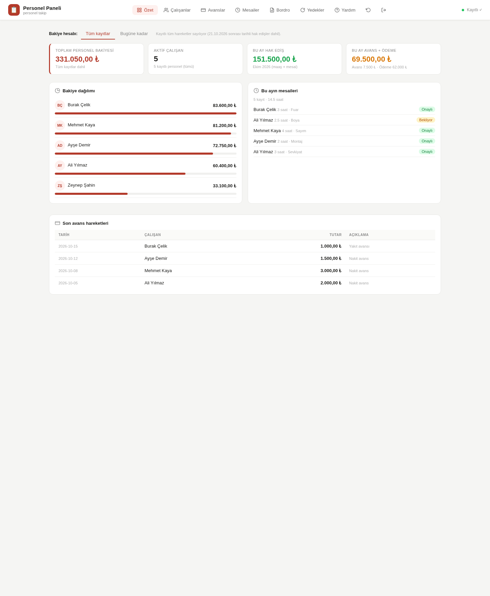

# Personnel Panel (Personel Paneli)

[Turkish](README.md) · English

[](https://github.com/tastoprak/personel-paneli/actions/workflows/test.yml)

**A single-file staff & payroll tracking panel** for small businesses: employees, cash advances,
overtime, monthly accruals and payments. **Zero third-party dependencies** — Python standard library
only, one HTML file, and all data in a single JSON file on your server.

- No ERP/accounting software to install, no cloud service, no data leaves the machine.
- It is a digital version of the notebook on your desk: record money movements, see who is owed what.



> The interface is in Turkish (the project targets Turkish SMEs); the code and docs are in both languages.

## Features

| Page | What it does |
|---|---|
| **Özet (Dashboard)** | Total outstanding, per-person breakdown, this month's overtime, latest advances. Balance mode: *all records* / *up to today* |
| **Çalışanlar** | Employees: code, position, net salary, hourly rate, hire / exit date, current balance |
| **Avanslar** | Advances, filtered by month/employee, with archive & deleted views |
| **Mesailer** | Overtime entries (reason + approval status) |
| **Bordro** | Pick a month → enter accruals/payments; **daily accrual** when hired/left mid-month; net and month-end balance computed automatically |
| **Yedekler** | Automatic backups: list, download, restore, JSON export |
| **Yardım** | In-app user guide |

Also:

- **Turkish number parsing**: `28.000`, `1.234,56`, `₺ 5.000`.
- **Daily accrual**: if the hire or exit date falls inside a month, salary is prorated by the **actual number
  of days in that month** (both the hire and exit day count) and written to accruals **automatically**.
  E.g. 30,000 TRY salary, 13–31 October = 19/31 days → **18,387.10 TRY**. If you enter an accrual manually for
  that month, the automatic calculation steps aside; auto records are tagged `kaynak: "gunluk-hesap"` and are
  refreshed when hire/exit dates or salary change. Full-month employees get no automatic record.
- **Autosave** (~1 s), with a status dot; unsaved changes kept as a browser draft.
- **Conflict safety**: two devices editing at once → `409` instead of silently overwriting; a save that
  would empty the employee list is rejected.
- **No hard deletes**: records are flagged as deleted (recoverable); employees are deactivated and stay in totals.
- **Backups**: one per save (last 60) plus a daily copy (last 30); restoring first backs up current state.
- **Auth**: cookie session (12 h), 5 failed logins → 5 min lock; password stored plaintext **or** as PBKDF2 hash.
- Mobile-friendly, single HTML file, no CDN/external assets (locked down with CSP).

## Quick start (try it)

```bash
git clone https://github.com/tastoprak/personel-paneli.git
cd personel-paneli
cp ornek-data.json data.json          # sample data — replace with your own

PANEL_KULLANICI=admin PANEL_PAROLA=test1234 python3 app.py
# open http://127.0.0.1:8090
```

No database, no build step, no service required. Your data *is* `data.json` — copy it to back it up.

## Production install

On Debian/Ubuntu with systemd:

```bash
printf '%s' 'a-strong-password' > PAROLA
sudo bash kur.sh
```

This installs to `/opt/personel-panel`, writes `/etc/personel-panel.env`, and starts
`personel-panel.service` bound to `127.0.0.1:8090`. To expose it, adapt `deploy/nginx-ornek.conf`
with your domain and issue a certificate (`certbot --nginx -d panel.example.com`).

## Configuration

| Variable | Default | Description |
|---|---|---|
| `PANEL_KULLANICI` | `admin` | Username |
| `PANEL_PAROLA` | — | Plaintext password (**required unless** `PANEL_PAROLA_HASH`) |
| `PANEL_PAROLA_HASH` | — | `pbkdf2_sha256$iter$salt$digest`, generated by `python3 parola-hash.py` |
| `PANEL_HOST` / `PANEL_PORT` | `127.0.0.1` / `8090` | Bind address/port |
| `PANEL_HTTPS` | `0` | `1` marks cookies `Secure` (use behind TLS) |
| `PANEL_OTURUM_SAAT` | `12` | Session lifetime (hours) |
| `PANEL_ADI`, `PANEL_ALT_BASLIK`, `PANEL_IKON` | `Personel Paneli`, —, `📋` | Branding (name, subtitle, logo emoji) |
| `PANEL_SLUG` | derived from name | Filename prefix for backups/exports |

## Data format

```jsonc
{
  "calisanlar": [ { "kod": "K001", "ad": "Ali Yılmaz", "maas": 32000, "girisTarihi": "2023-03-15",
                    "cikisTarihi": "", "devir": 62400, "aktif": true, ... } ],
  "hakEdisler": [ { "tarih": "2026-10-31", "kod": "K001", "tutar": 32000, "aciklama": "..." },
                  { "tarih": "2026-10-31", "kod": "K006", "tutar": 18387.10,
                    "aciklama": "Ekim 2026 hak edişi (13–31 Eki · 19/31 gün)",
                    "kaynak": "gunluk-hesap", "gun": 19, "ayGun": 31, "maas": 30000 } ],
  "avanslar":   [ { "tarih": "2026-10-05", "kod": "K001", "tutar": 2000, "aciklama": "..." } ],
  "odemeler":   [ { "tarih": "2026-10-03", "kod": "K001", "tutar": 32000, "aciklama": "..." } ],
  "mesailer":   [ { "tarih": "2026-10-03", "kod": "K001", "saat": 3, "sebep": "Sevkiyat", "onay": "Onaylı" } ]
}
```

- **Balance = `devir` + Σ accruals − Σ advances − Σ payments** (records flagged `arsiv`/`silindi` excluded).
- `devir` is the opening balance at the moment you start tracking. Put older movements in with
  `"arsiv": true` — they stay visible but are not counted twice.
- Deletions set `"silindi": true` (recoverable). `aktif: false` hides an employee but keeps their balance in totals.
- `cikisTarihi` is the exit date (empty = still employed). In the hire/exit month the salary is prorated daily;
  an auto-generated accrual carries `kaynak: "gunluk-hesap"`, `gun`, `ayGun`, `maas`. Once such a record is
  flagged `silindi: true` it is never regenerated.
- The server writes `_guncelleme` on every save (used for conflict detection).

## Security notes

- This panel holds **salary data**: always run it behind HTTPS (`PANEL_HTTPS=1`) and never bind it to a
  public interface. Put a reverse proxy in front.
- Single-user by design. Prefer `PANEL_PAROLA_HASH` (PBKDF2) over plaintext; if you keep plaintext, `chmod 600`
  the env file.
- Sessions live in memory: restarting the service logs everyone out.
- `data.json` and its backups are unencrypted — anyone with filesystem access reads everything.
- No external calls, no telemetry, no CDNs.

## Tests

```bash
node test/test_mantik.js        # 101 checks: panel logic without a browser
bash test/test_http.sh          # 34 checks: HTTP behaviour (auth, conflicts, backups, limits)
bash test/ekran-goruntusu.sh    # screenshots (needs chromium)
```

They run against `ornek-data.json` and never touch your data. CI runs on every push.

## Limitations

- One user, one file, one process. No roles, no multi-company, no accounting integration.
- Not a payroll system: it tracks amounts you enter, it does not compute taxes/SGK.
- Overtime hours are informational; the paid amount is entered as an accrual (avoiding double counting).

## Release notes

### v1.1.0 — 2026-10-21
- **Daily accrual (new):** when the hire or exit date falls inside a month, salary is prorated by the actual
  number of days in that month (hire and exit day inclusive) and written to accruals automatically.
  - No automatic record for full-month employees; a manual accrual in that month disables the automatic one.
  - Auto records are tagged `kaynak: "gunluk-hesap"`; they follow hire/exit/salary corrections and are never
    regenerated once deleted.
  - Only months covered by tracking are touched (no writes into archived or future months).
- **Employees:** exit date field (validated against the hire date), "Hire / Exit" column and a "left" badge.
  No automatic deactivation.
- **Bordro:** "Daily accrual" column (day range · n/m days · amount · auto/manual tag) and updated help text.
- **Fix:** editing an employee no longer silently re-activates a deactivated record.
- **Tests:** 63 → **101** logic checks.

## Contributing

Please use the **issue forms** for bug reports and feature requests (the repository ships templates in both
Turkish and English). **Never include real employee names, salaries or customer data** in a report — made-up
examples (see `ornek-data.json`) are enough to reproduce a problem. Report security issues
[privately](https://github.com/tastoprak/personel-paneli/security/advisories/new).

When proposing a code change, run the tests (`node test/test_mantik.js && bash test/test_http.sh`).

## License

[MIT](LICENSE) — free to use, modify and distribute, including commercially.
